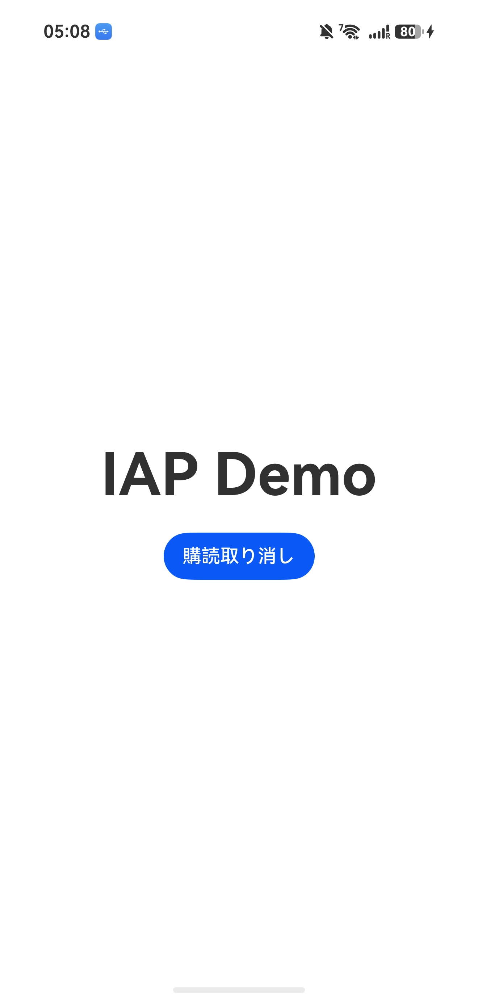
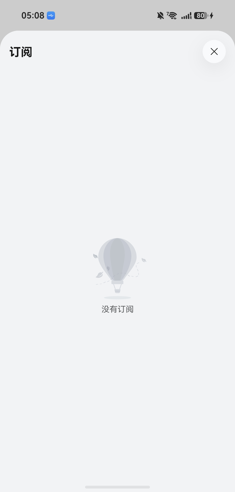

# HarmonyOS NEXT 订阅管理页面跳转 Demo (IAP Kit)

本示例应用展示了如何在 HarmonyOS NEXT (ArkTS / Stage Model) 环境下，使用 `@kit.IAPKit` 调用应用内支付（订阅）管理与取消订阅页面（`iap.showManagedSubscriptions`）。

## 页面截图

| 主界面 (`image/main.jpg`) | 订阅管理界面 (`image/open.jpg`) |
| :---: | :---: |
|  |  |

## 概述

在此示例中，点击“取消订阅”按钮后，将直接调起与 HUAWEI ID 关联的订阅管理弹窗（或页面）。

### 主要功能与要点

- **调用 `@kit.IAPKit`**：传入正确的参数结构（`UIAbilityContext`, `UIWindowParameter`, `groupId`）启动 `iap.showManagedSubscriptions`。
- **指定 `UIWindowParameter`**：指定 `iap.WindowScreenMode.DIALOG_BOX` 以弹窗形式进行展示。
- **ArkTS 推荐 Context 获取方式**：使用 `this.getUIContext().getHostContext()` 以类型安全的方式获取 Context。
- **简化调用**：如果仅以打开订阅管理页面为目的，无需进行特定的订阅组 ID（Group ID）配置。

---

## 前置准备与前提条件

为了使 `iap.showManagedSubscriptions` 正常运行，需要在 AppGallery Connect (AGC) 进行最基础的配置，并在合适的测试环境下运行。

### 1. AppGallery Connect (AGC) 配置

1. **开启应用内支付（IAP）服务**：
    - 登录 [AppGallery Connect](https://developer.huawei.com/consumer/cn/service/josp/agc/index.html)。
    - 进入对应项目的 `项目设置 > 常规`，将 **应用内购买 (In-App Purchases)** 服务设置为开启（ON）。
2. **注册 SHA256 证书指纹**：
    - 获取用于构建和签名的密钥库 (Keystore) 的 **SHA256 指纹**。
    - 在 AGC 的 `常规 > SHA256证书/公钥指纹` 中准确填入并保存。

> **注意**：对于 HarmonyOS NEXT 应用，如果仅调起通用订阅管理页面，**无需**手动配置 `agconnect-service.json`，也**无需**提前在账号后台注册具体的订阅商品（Group ID）。

### 2. 运行与测试环境注意事项

- **必须使用真机测试**：
  IAP Kit 的各种 UI 界面（支付界面、订阅管理界面）**不支持模拟器**。请务必使用 HarmonyOS NEXT 真机设备进行测试。
- **登录 HUAWEI ID**：
  测试设备必须已登录有效的 **HUAWEI ID**。

---

## 错误排查（Troubleshooting）

| 错误码 | 错误信息 | 主要原因与解决方案 |
| :--- | :--- | :--- |
| **`1001860002`** | `The application is not authorized.` | AGC 侧**未开启 IAP 服务**，或者构建时的签名（Keystore）**SHA256 指纹**与 AGC 上的注册不一致。请检查 AGC 控制台配置。 |

---

## 运行环境

- **DevEco Studio**：DevEco Studio 5.0 / API 12 (HarmonyOS NEXT) 及以上
- **开发语言**：ArkTS (Stage Model)